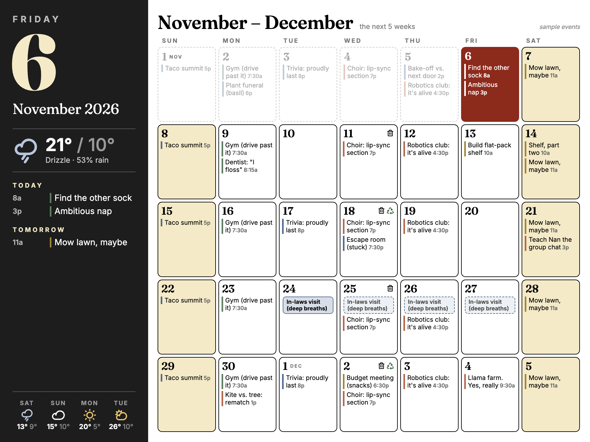

# Month Ahead

A wall calendar for a whole Tesserae panel. Today sits up close in its own panel: a big date,
today's weather and the next four days, what's on today and tomorrow, and a "Bins out tonight"
card on bin night. Beside it (or above it, on a portrait panel) the next five weeks are laid out
as tiles, every event edged in its calendar's colour.

## Looks

| Look | Feel |
|---|---|
| **Noir** | A dark today panel, soft tiles, a Fraunces serif |
| **Paper** | A printed desk planner: ruled, italic Cormorant Garamond headings |
| **Poster** | Heavy Archivo capitals, thick-bordered tiles, hatched multi-day events |
| **Ledger** | Monospaced IBM Plex Mono, dotted rules, `> FRIDAY` and `#12` |
| **Soft** | Light Manrope, white rounded tiles, a rounded today panel |

Each look comes in **muted colour** (dithered rust, slate, ochre, sage and cream, chosen to sit
quietly on a Spectra 6 panel) or **black and white** for greyscale panels.

## Options

| Option | What it does |
|---|---|
| Look | One of the five above |
| Colour | Muted colour, or black and white |
| Today panel | Off gives the grid the whole cell and puts each day's weather in the corner of its tile |
| Weather for | A city or `lat, lon`. Blank uses the app's own location; with neither, no weather |
| Units | °C or °F |
| Calendars | Feed IDs from Calendar Feeds, comma separated. Blank shows every enabled feed |
| Weeks shown | 4, 5 or 6, starting at the week holding today |
| Week starts on | Sunday or Monday |
| Bin night | A weekday; puts a bin on that tile and the card in the today panel |
| Recycling | Every bin night, every other one, or not shown |
| A recycling night | Any date recycling went out, so fortnightly recycling lands on the right weeks |

## Where the data comes from

Month Ahead asks two widgets Tesserae already ships, rather than fetching anything itself:

- **Calendar, Month** lays out the events from **Settings › Calendar Feeds** (multi-day events
  included), each tagged with its feed's colour. That colour is what edges the event here.
- **Weather, Forecast** brings Open-Meteo's next five days, cached for ten minutes.

Event times are written in the app's own time zone, short enough for a narrow tile (`6:30p`).

Until a calendar feed is set up the grid shows a made-up household (a taco summit, a plant
funeral, a visit from the in-laws) marked "sample events", so you can judge the layout first.
Once any feed exists, a quiet month shows as a quiet month.

## Panels

The layout is drawn at a panel's own proportions (1872 wide in landscape, 1200 in portrait) and
scaled to the cell, so it keeps its shape on any size. It is meant to fill a panel; on small
cells the type gets small.

## Fonts

Fraunces, Inter, Cormorant Garamond, Archivo, IBM Plex Mono and Manrope ship in `static/fonts`
under the SIL Open Font License (see `static/fonts/LICENSE-fonts.txt`).

## Licence

AGPL-3.0, see `LICENSE`.
